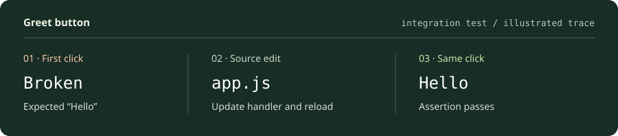
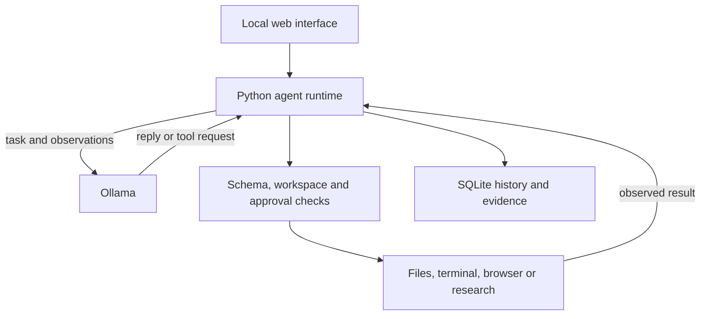

# Workhorse

**A local AI assistant that can show its work.** Workhorse connects an Ollama model to a project folder, a terminal and a browser on your machine. Ask it to fix a website and you can follow the edits, see the running page and check whether the fix passed. For everyday tasks, the same interface can draft a customer reply, turn meeting notes into actions or research a question.

**Stack:** Python · SQLite · Ollama · Playwright · SearXNG · vanilla JavaScript

[Run it on Windows](#run-it-on-windows) · [Walk through a real test](#a-fix-you-can-reproduce) · [Architecture](docs/architecture.md) · [Permissions](SECURITY.md)

## A fix you can reproduce



One [integration test](tests/test_development.py) builds a tiny page with a **Greet** button. The click handler initially displays `Broken`. Workhorse starts the site, clicks the button in Chromium and records a failed assertion. It edits the handler, reloads, clicks again and verifies `Hello`. The test checks the two assertion results in order, the changed source file, the detected local URL and the saved screenshot.

The test scripts the model’s decisions so it’s repeatable without a GPU. The file edits, dev server, browser and assertions are real. To run this example from a configured Windows checkout with Node.js on PATH:

```powershell
$env:WORKHORSE_BROWSER_TESTS = '1'
.\.venv\Scripts\python.exe -m unittest discover -s tests -p test_development.py -v
```

## What you can do

| Task | What happens |
| --- | --- |
| **Build or fix an app** | Approve a project directory. The agent can inspect source, propose terminal commands, edit files and retest. **Preview & files** shows captures as it uses the browser. |
| **Research a question** | Enable internet access. The agent can search through your SearXNG instance, read pages and make follow-up searches. Results and pages are cached locally. |
| **Prepare a handover** | Choose **Reception & admin**, paste your notes and ask for outstanding requests and missing details. Workhorse can draft the handover; it has no built-in booking or messaging integration. |
| **Brief a team** | The **Management** profile helps turn notes into decisions, owners and next steps. Saved preferences carry across conversations. Profiles change how the model responds; workspace permissions still control what it can do. |

## Run it on Windows

1. Install **Python 3.12+** and **Ollama**. Download a local model, then run `ollama list` to see its exact name. Choose a tool-capable model for development and a vision-capable model if you want screenshot review.
2. For search and the standard desktop launcher, install **Docker Desktop** with Linux containers enabled. For local use without Docker, use the command below.
3. Download or clone this repository to a permanent folder. Double-click **[Setup.cmd](Setup.cmd)** once. It installs the Python dependencies and Chromium, checks local startup, and builds the desktop shortcut.
4. Open **Workhorse** from the shortcut or run **[Workhorse.cmd](Workhorse.cmd)**. In [the local interface](http://127.0.0.1:8765), open **Local model settings → Find installed models**. Set the coding, design and screenshot-review models to tags you actually have installed.

After setup, to start without web search or Docker:

```powershell
.\start-workhorse.cmd -WithoutSearch
```

Model weights are separate downloads. Inference and history stay on your machine; enabling web research sends queries and page requests to external sites. See [setup and troubleshooting](docs/setup.md) for the ports, health check, launcher and older installations.

## How it works

Ollama proposes a structured tool call. Workhorse validates its arguments, checks the selected workspace and requests approval where needed. The tool returns an observation, which the model can use to choose its next action. SQLite stores thread history, tool results and file changes. A progress screenshot shows what the browser saw; it doesn’t count as a passed test.



Start with the [runtime](workhorse/runtime.py), the [tool registry](workhorse/tools.py) or the [browser adapter](workhorse/browser.py). The [architecture guide](docs/architecture.md) follows one task across those files.

## Verification and scope

The [test guide](docs/testing.md) separates deterministic model fixtures, real browser tests and live-model checks. [GitHub Actions](.github/workflows/tests.yml) defines Linux and Windows checks.

Workhorse is designed for one trusted user on one computer. File tools operate in an approved workspace. An approved **native command runs with your Windows user permissions**; its working directory is not an operating-system sandbox. See the [security model](SECURITY.md) before enabling terminal access for an unfamiliar project.
