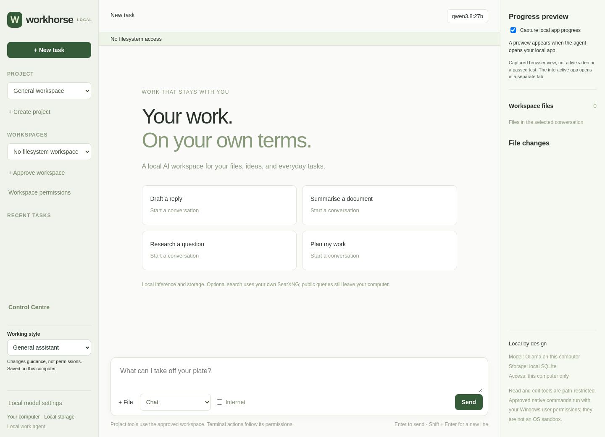
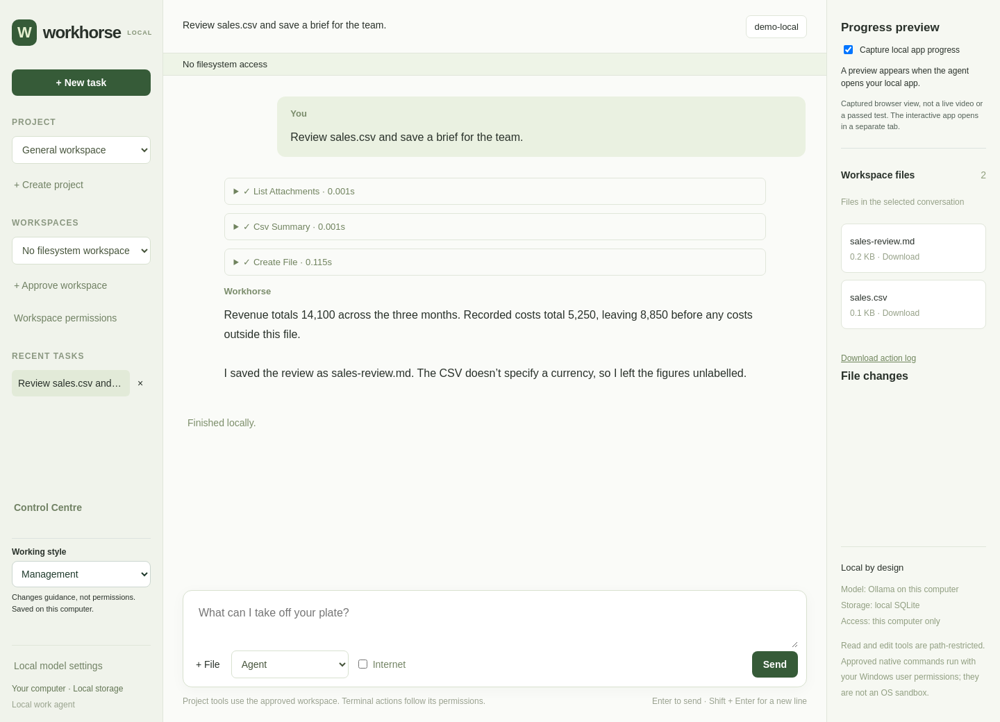

# Workhorse

**A local AI assistant for the work between meetings.** Give Workhorse a spreadsheet, a set of handover notes or a project folder. It can review the material, flag what needs your attention and produce a file you can use. Start a task, keep working in another app, and come back to the result and a record of how it got there.

[Run it on Windows](#run-it-on-windows) · [Try a sales review](#try-a-sales-review) · [Architecture](docs/architecture.md) · [Permissions](SECURITY.md)

[](docs/workhorse-home.png)

*The Workhorse home screen. Choose a working style on the left, give the assistant a task in the centre, and find its files and previews on the right.*

## Try a sales review

1. Open a new task, choose **Agent**, and attach the included [sales.csv](examples/sales.csv) using **+ File**. This example needs a local model with tool support; it doesn't need internet access or access to a project folder.
2. Ask: **“Review the three months in this CSV. Total revenue and costs, flag anything I should check before sharing, and save a short brief as sales-review.md.”**
3. When Workhorse asks to create the file, expand **Review proposed contents**. Approve it, then download the brief from **Workspace files**.

The sample contains **14,100** in revenue and **5,250** in recorded costs. It doesn't specify a currency. Those are useful checks on the review before passing it to a colleague.

[](docs/workhorse-sales-review.png)

*Captured in the running app with the sample CSV. The demo scripted the model’s decisions; the CSV calculation, approval, file creation and download all ran through Workhorse. A live model may word the brief differently.*

## What else can you hand over?

Attach plain text, Markdown, CSV or supported code files. For a PDF, Word document or Excel workbook, export the relevant text or CSV first.

| When you need to… | Give Workhorse this task |
| --- | --- |
| Review a proposal before a meeting | “Compare this draft with the attached requirements. Quote the passages that meet them, flag gaps, and save a review checklist.” |
| Prepare the next shift | “Turn these reception notes into a handover. Separate confirmed arrangements from requests that still need a reply. Leave unknown details blank.” |
| Brief a team | “Read these meeting notes and draft a one-page update. Separate decisions from open questions. Include owners and deadlines only where the notes name them.” |
| Research a decision | “Look up the two options, compare them against these criteria and link the sources you used.” Enable internet access to use your own SearXNG instance. |
| Review or fix software | “Inspect this project, reproduce the broken interaction, fix it and run the relevant tests.” Use **Development / Work** with an approved project folder. The activity panel records tool results; the preview shows the local page as the agent works. |

**While you're doing other work:** the local server runs the task independently of the active browser tab. Keep the server running and return for approval prompts. Workhorse supports one active agent run at a time; separate conversations keep past tasks, files and results available. It can draft messages and handovers, but has no built-in email or calendar integration.

## Run it on Windows

1. Install **Python 3.12+** and **Ollama**. Download a local model with tool support; run `ollama list` to see its exact name. Install **Docker Desktop** with Linux containers enabled if you want web search or the standard desktop launcher.
2. [Download the source ZIP](https://github.com/BenjaminLobl/workhorse/archive/refs/heads/main.zip) or clone this repository. Extract it to a permanent folder and double-click **[Setup.cmd](Setup.cmd)** once. Setup installs Python dependencies and Chromium, checks that Workhorse starts, and creates the desktop shortcut.
3. Open the **Workhorse** shortcut or run **[Workhorse.cmd](Workhorse.cmd)**. In the [local interface](http://127.0.0.1:8765), open **Local model settings → Find installed models** and select an installed model. A separate vision model is optional for screenshot review.

To start after setup without Docker or web search:

```powershell
.\start-workhorse.cmd -WithoutSearch
```

Inference, conversations and files stay on your machine by default. If you enable research, search queries and page requests reach external sites. See [setup and troubleshooting](docs/setup.md) for local ports, startup checks and existing installations.

## Under the hood

**Python · SQLite · Ollama · Playwright · SearXNG · vanilla JavaScript**

Ollama chooses a tool. The [runtime](workhorse/runtime.py) checks its arguments, the workspace permissions and any required approval before it acts. The result goes back to the model so it can correct an error or continue the task. SQLite keeps the conversation and activity record. File tools are limited to an approved folder; an approved native command runs with your operating-system permissions.

- [Architecture](docs/architecture.md) — follow a task from the browser through the agent loop and back.
- [Tests and verification](docs/testing.md) — run the test suite, including a [browser scenario](tests/test_development.py) that reproduces a broken button, edits the code and verifies the fix.
- [Security model](SECURITY.md) — understand file access, command approvals and the limits of a single-user local installation.
